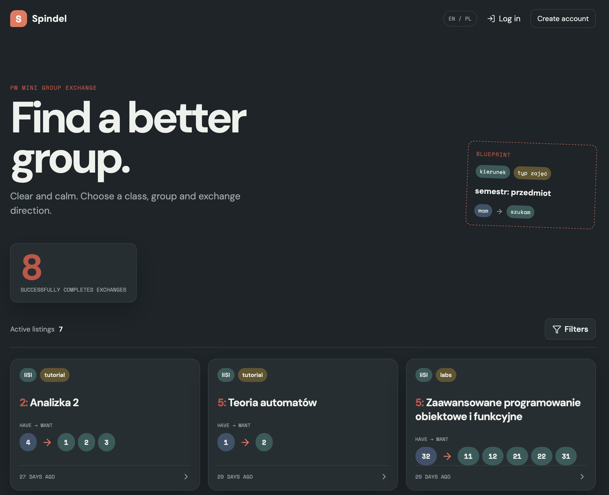
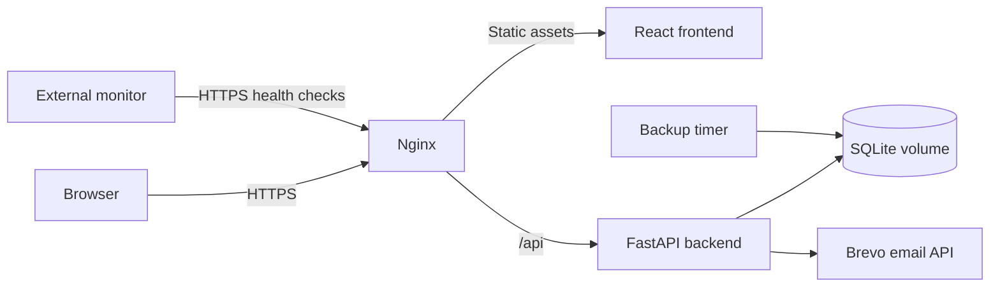

# Spindel — class group exchanges for PW students

[](https://github.com/welmac0/spindel.pl/actions/workflows/ci.yml)

Spindel helps Warsaw University of Technology students find someone to exchange class groups with. Students verify their university email, publish a listing, and confirm a match before exchanging contact details. It coordinates exchanges; it does not change university enrollment records.

**Live application:** [spindel.pl](https://spindel.pl) · **Status:** beta · **Interface:** Polish and English



## Features

- University email verification, cookie-based sessions, and password reset.
- Listings with filters, multiple desired groups, and duplicate/conflict checks.
- Exchange requests with owner confirmation, expiration, and delayed contact disclosure.
- Transactional email through Brevo.
- Production deployment on a Hetzner VPS with HTTPS, persistent SQLite storage, backups, and health monitoring.

## Architecture

| Layer | Technology |
| --- | --- |
| Frontend | React, TypeScript, Vite |
| Backend | Python 3.13+, FastAPI, SQLModel |
| Database | SQLite |
| Infrastructure | Docker Compose, Nginx, Certbot, systemd |
| Automation | GitHub Actions, uv, npm |



The single-host architecture keeps deployment and operations small. Its trade-offs include no host-level high availability, process-local rate limiting, synchronous email delivery, and no automated schema migrations. See [architecture](docs/architecture.md) for details.

## Local development

### Native setup

Requirements: **Python 3.13+**, [uv](https://docs.astral.sh/uv/getting-started/installation/), and **Node.js/npm**. CI uses Python 3.13 and Node.js 26.

From the repository root:

```bash
cp .env.example .env
uv sync --locked
uv run uvicorn wymiana_zajec.main:app --reload
```

In a second terminal:

```bash
cd frontend
npm ci
npm run dev
```

Open **http://localhost:5173**. Use this hostname consistently for browser sessions. Vite proxies `/api` to the backend at port 8000. Interactive API documentation is at **http://localhost:8000/docs**.

SQLite tables are created on startup; native development uses a local database in the repository root. No production database or server access is needed.

**Email-dependent flows require your own Brevo API key and verified sender** in the local environment file. Empty credentials do not enable mock email or bypass university email verification. The API can start without email credentials, but email-dependent flows will not fully work. Automated tests mock email delivery and need no Brevo account.

Configuration details, including Docker development and production URL differences: [architecture and setup](docs/architecture.md#configuration).

### Docker Engine and Compose

Alternatively, run both services with **Docker Engine and the Docker Compose plugin** (or Docker Desktop). The Docker daemon must be running; Python and Node.js are built into the images and do not need to be installed on the host.

Create a local `.env` from [.env.example](.env.example) if you have not already done so. Do not overwrite an existing configuration. For Docker development, set:

```dotenv
APP_BASE_URL=http://localhost:8000
FRONTEND_URL=http://localhost:5175
ALLOWED_ORIGINS=http://localhost:5175
ALLOWED_HOSTS=localhost,127.0.0.1
SESSION_COOKIE_SECURE=false
```

From the repository root, create the required external volume and start the services:

```bash
docker volume create docker_wymiana_data
docker compose -f docker/compose.yaml up --build -d
docker compose -f docker/compose.yaml ps
```

Open **http://localhost:5175**. Backend API documentation remains at **http://localhost:8000/docs**. Stop any native backend already using port 8000 before starting Compose. Email-dependent flows still require valid Brevo credentials.

To inspect logs or stop the services:

```bash
docker compose -f docker/compose.yaml logs -f backend frontend
docker compose -f docker/compose.yaml down
```

SQLite data persists in `docker_wymiana_data` after stopping containers. Do not delete this volume to restart or rebuild the application. Development and production Compose reference the same volume name: use a separate Docker host or explicitly separated volumes for local development, never production data. Source changes require rebuilding the relevant image; this setup does not provide live reload.

## Tests and CI

```bash
uv run pytest -q
bash tests/test_external_monitor.sh
```

To type-check and build the frontend:

```bash
cd frontend
npm run build
```

CI runs backend tests, the frontend build, shell syntax checks, external monitor tests, and production Compose configuration validation. Browser E2E tests are not configured. See [testing](docs/testing.md) for scope and manual smoke tests.

## Documentation

- [Documentation index](docs/WIKI.md)
- [Architecture and local setup](docs/architecture.md)
- [API and domain rules](docs/api.md)
- [Security design](docs/security.md)
- [Testing](docs/testing.md)
- [Deployment, backups, and monitoring](docs/operations.md)
- [Contributing](CONTRIBUTING.md) · [Reporting vulnerabilities](SECURITY.md)

Current work is tracked in [GitHub Issues](https://github.com/welmac0/spindel.pl/issues). Existing TODO files are supplementary checklists, not a release guarantee.

## License

Copyright © 2026 Maciej Welpa. All rights reserved. The project is publicly viewable but is not currently open source. See [LICENSE](LICENSE) for details.
